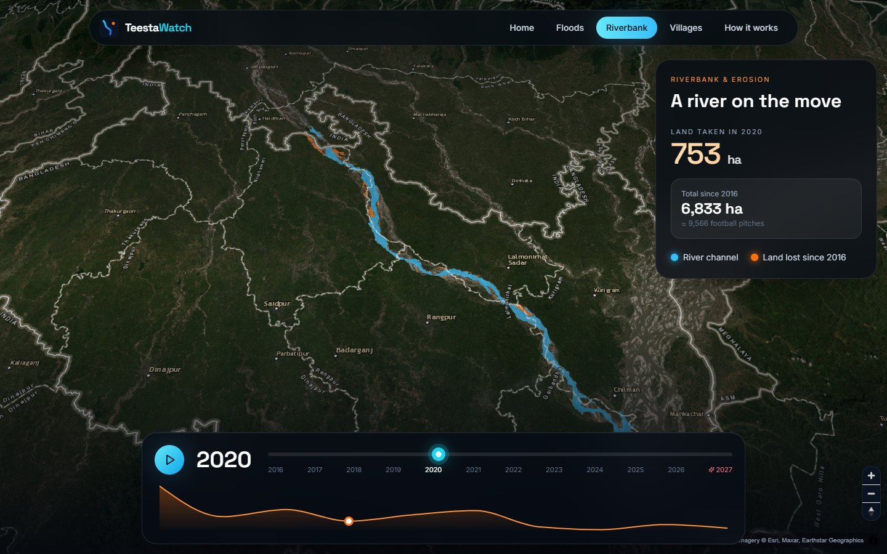
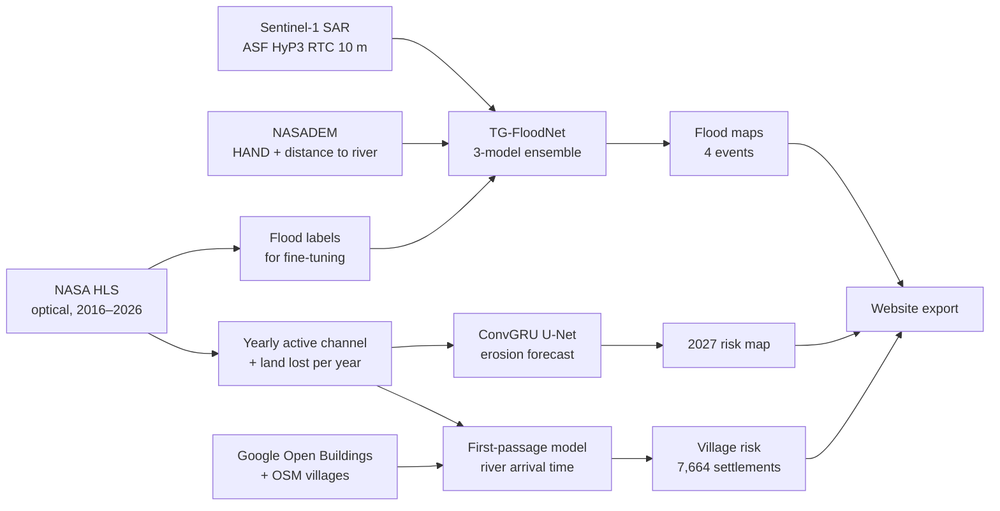

# TeestaWatch ML

The AI and data pipeline behind **[TeestaWatch](https://aayathossain.github.io/teestawatch-web/)**. It maps floods, tracks riverbank erosion, forecasts next year's land loss, and ranks the villages in the path of the Teesta River in northern Bangladesh, using NASA and Sentinel-1 satellite data.

<p align="center">
  
  
  
  
</p>

## At a glance

| | |
|---|---|
| River corridor monitored | 1,609 km² |
| Satellite images processed | 756 |
| Land taken by the river, 2016–2026 | 10,777 ha |
| Homes analysed one by one | 395,693 in 7,664 settlements |
| Land at high risk of erosion in 2027 | 281 ha (plus 357 ha medium risk) |

## Results

### Beats NASA's own flood product by 66% on real Teesta floods

| What the AI does | How well | What it means |
|---|---|---|
| **Maps floods** from radar satellite images | **82% F1** on 50 flood scenes it never saw | Sees flood water through monsoon clouds, day or night. 87% of the water it marks is real water |
| **Outperforms NASA OPERA**, the official flood product | **0.72 vs 0.43 IoU** on the same 2025 floods | 66% more accurate, checked against hand-drawn ground truth |
| **Forecasts riverbank erosion** a year ahead | **0.92 and 0.95 AUC** on two future years | Ranks land the river will take above safe land 92–95% of the time, ahead of a recent-erosion baseline (0.84, 0.91) |
| **Predicts when the river reaches each home** | **0.85 AUC** over a 6-year backtest | Given only 2016–2019, it ranked land the river reached by 2025 above land it spared 85% of the time |

Every score comes from data the models never trained on. Full numbers are in [results/metrics.json](results/metrics.json).

## How it works



**TG-FloodNet (Terrain-Gated Flood Network).** A ResNet-34 U-Net that reads radar backscatter (VV, VH, VV−VH) together with two terrain layers: height above the nearest drainage and distance to the stream. The terrain branch gates the decoder, so the model learns that water collects in low ground near channels and is unlikely on high ground, even where radar alone is ambiguous. It is trained on Sen1Floods11, then fine-tuned on the Teesta with labels taken from cloud-free NASA HLS optical images, replaying Sen1Floods11 to keep its general skill. Three seeds are averaged.

**ConvGRU U-Net erosion forecast.** For each 30 m pixel near the river, the model reads five years of dry-season history (water, sand, MNDWI, NDVI, the active channel and the land already reached) plus terrain. A convolutional GRU carries the river's movement through time, and a U-Net decoder predicts which land the river will reach next year. The release model is retrained on 2018–2026 and forecasts 2027.

**Village risk.** Every Google Open Buildings footprint inside the corridor is scored. Bank retreat rates measured along 250 m transects feed a first-passage (inverse-Gaussian) model that gives each home the probability of the river reaching it within 1, 3 and 5 years. Homes are grouped into settlements and named from OpenStreetMap and administrative boundaries.

## Repository layout

```
pipeline/              numbered steps, run in order
  common.py            paths, the shared EPSG:32645 grid, raster helpers
  s01-s10              study area, NASA/ASF downloads, HyP3 radar, DEM/HAND, terrain, radar mosaics
  s11-s12              hand-labelling tiles and the browser labelling tool
  s13-s15              flood labels, fine-tuning pack, flood maps
  s16-s19              active channel, erosion history, forecast data, 2027 forecast
  s20-s21              building footprints, village risk
  s22                  independent hand-label evaluation
  s23                  export for the website
models/
  flood/tgfloodnet.py        TG-FloodNet, Sen1Floods11 training
  flood/finetune_teesta.py   Teesta fine-tuning
  erosion/convgru_unet.py    erosion forecast training and evaluation
evaluation/hand_labels/      50 hand-labelled test tiles (2 labellers)
data/aoi/                    study-area and river geometry
results/metrics.json         test scores
```

## Getting started

```bash
git clone https://github.com/AayatHossain/teestawatch-ml.git
cd teestawatch-ml
python -m venv .venv && source .venv/bin/activate   # Windows: .venv\Scripts\activate
pip install -r requirements.txt
```

Python 3.12. A CUDA GPU is recommended for inference and needed for training.

**Credentials.** Downloads use a free [NASA Earthdata](https://urs.earthdata.nasa.gov/) account. Put it in `~/.netrc`:

```
machine urs.earthdata.nasa.gov login <user> password <password>
```

**Trained weights.** Download `teestawatch-ml-weights.zip` from the [latest release](https://github.com/AayatHossain/teestawatch-ml/releases/latest) and unzip it in the repository root:

```
weights/flood/seed0.pt  seed1.pt  seed2.pt  norm.json
weights/erosion/seed0.pt  seed1.pt  seed2.pt
```

## Running the pipeline

Run the steps from inside `pipeline/`, in order. Each one reads the outputs of the earlier steps from `data/` and writes its own. With the released weights, the steps below rebuild every map and number:

```bash
cd pipeline
python s01_study_area.py
python s03_download_nasa.py          # HLS, OPERA DSWx, NASADEM
python s05_s1_search.py
python s06_order_hyp3.py             # orders RTC processing on ASF HyP3
python s07_fetch_hyp3.py
python s08_dem_hand.py
python s09_terrain.py
python s10_s1_mosaic.py
python s15_flood_maps.py             # flood maps with TG-FloodNet
python s16_channels.py
python s17_erosion.py
python s18_erosion_pack.py
python s19_erosion_forecast.py       # 2027 erosion risk
python s20_buildings.py
python s21_village_risk.py
python s22_hand_label_eval.py        # reproduces the flood test scores
python s23_web_export.py             # writes web_data/ for the website
```

The remaining steps are only needed to retrain or relabel: `s02` lists the available NASA granules, `s04` downloads Sen1Floods11, `s11`-`s12` build the hand-labelling pages, and `s13`-`s14` build the Teesta fine-tuning set.

**Training from scratch.**

| Model | Data | Command |
|---|---|---|
| TG-FloodNet | Sen1Floods11 (`s04`, terrain from `s09`) | `python models/flood/tgfloodnet.py` |
| Teesta fine-tuning | `s13` + `s14` | `python models/flood/finetune_teesta.py` |
| ConvGRU U-Net | `s18` | `python models/erosion/convgru_unet.py` |

Outputs go to `runs/<model>/`.

| Setting | Effect |
|---|---|
| `TW_SMOKE=1` | Quick run on a small slice, to check that everything works |
| `TW_FINAL=1` | ConvGRU only: train on 2018–2026 for the 2027 release model |
| `TW_OUT` | Output folder (default `runs/<model>`) |
| `TW_DATA`, `TW_TERRAIN` | Sen1Floods11 folder and its terrain layers (default `data/sen1floods11`) |
| `TW_FT`, `TW_EROSION_DATA` | Fine-tuning pack and erosion stacks (default `data/ft_teesta`, `data/erosion_pack`) |
| `TW_EPOCHS`, `TW_STEPS` | Override the training length |

## Data sources

| Data | Provider | Licence |
|---|---|---|
| Sentinel-1 RTC (10 m) | ESA Copernicus, processed by ASF HyP3 | Copernicus open licence |
| HLS L30/S30 optical | NASA LP DAAC | Open (NASA EOSDIS) |
| OPERA DSWx-HLS, DSWx-S1 | NASA JPL / PO.DAAC | Open (NASA EOSDIS) |
| NASADEM | NASA LP DAAC | Open (NASA EOSDIS) |
| Sen1Floods11 | Cloud to Street | CC BY 4.0 |
| Google Open Buildings (VIDA merge) | Google, VIDA via Source Cooperative | CC BY 4.0 / ODbL |
| Rivers, villages | © OpenStreetMap contributors | ODbL |
| Administrative boundaries | geoBoundaries | CC BY 4.0 |

## Live demo

**https://aayathossain.github.io/teestawatch-web/**

## License

Code is released under the [MIT License](LICENSE). Data products follow the licences of their sources above.
