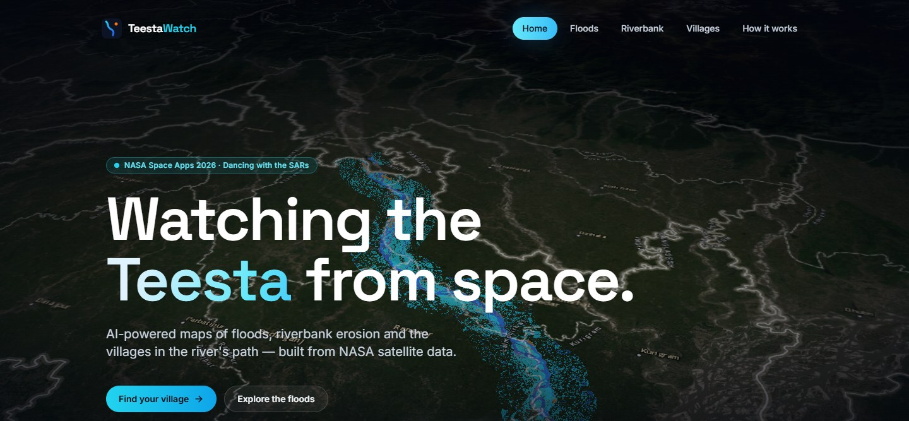
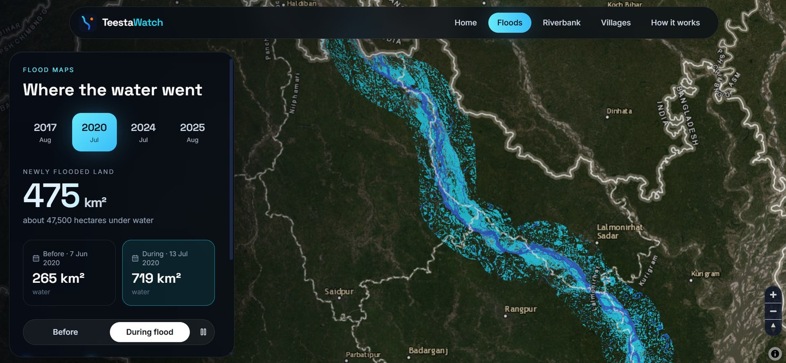
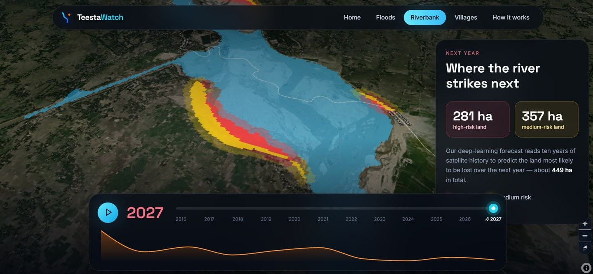
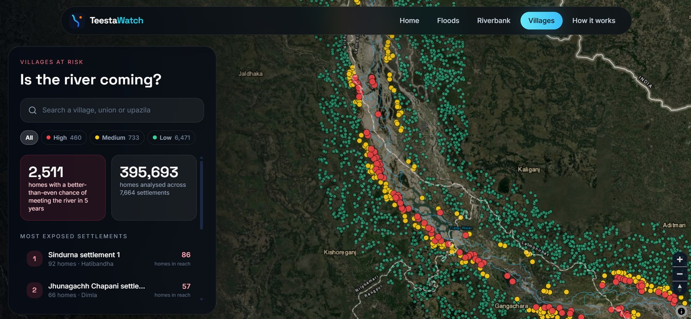
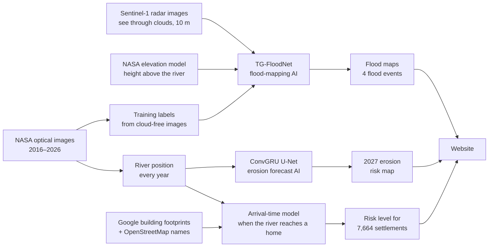

# TeestaWatch ML

The AI and data pipeline behind **[TeestaWatch](https://aayathossain.github.io/teestawatch-web/)**. It maps floods, tracks riverbank erosion, forecasts next year's land loss, and ranks the villages in the path of the Teesta River in northern Bangladesh, using NASA and Sentinel-1 satellite data.

<p align="center">
  
</p>
<p align="center">
  
  
  
  
</p>

## The problem

The Teesta River in northern Bangladesh floods every monsoon, and it keeps shifting sideways, eating into its banks. Between 2016 and 2026 it took 10,777 ha of land: fields, roads and homes. People living along it need answers to three questions:

1. **Where is the water right now?** Floods come in the monsoon, when thick clouds hide the ground from normal satellite cameras.
2. **Which land will the river take next?** The river changes course every year, so last year's map is already out of date.
3. **Which villages are in danger first?** Help is limited, so it has to go where the river will arrive soonest.

## How this project helps

| Question | Answer |
|---|---|
| Where is the water? | Flood maps from radar satellites, which see through clouds, day or night |
| Which land goes next? | A forecast of the land the river is likely to take in 2027 |
| Which villages first? | 7,664 settlements ranked by how soon the river is likely to reach them |

Everything is shown on a free public website: **[TeestaWatch](https://aayathossain.github.io/teestawatch-web/)**.

## What's inside

- **Data pipeline.** Pulls Sentinel-1 radar, NASA optical images, NASA water maps and elevation data, processes them, and puts them all on one common map grid.
- **TG-FloodNet.** The flood-mapping network: its design, its training on a public flood benchmark, and its fine-tuning on the Teesta.
- **Erosion forecast.** The ConvGRU U-Net that predicts which land the river will take next year.
- **Village risk model.** Estimates when the river will reach each of 395,693 homes.
- **Evaluation.** The independent test on 50 hand-labelled tiles, including the comparison with NASA's own flood product.
- **Website data.** The export that turns every result into the maps and numbers on the website.

## At a glance

| | |
|---|---|
| River corridor monitored | 1,609 km² |
| Satellite images processed | 756 |
| Land taken by the river, 2016–2026 | 10,777 ha |
| Homes analysed one by one | 395,693 in 7,664 settlements |
| Land at high risk of erosion in 2027 | 281 ha (plus 357 ha medium risk) |

## Results

### 66% better than NASA's own flood product on the 2025 Teesta flood

| What the AI does | How well | What it means |
|---|---|---|
| **Maps floods** from radar satellite images | **0.82 F1, 0.69 IoU** on 50 hand-labelled test tiles it never saw | Sees flood water through monsoon clouds, day or night. 87% of the water it marks is real water |
| **Outperforms NASA OPERA**, the official flood product | **0.72 vs 0.43 IoU** on the same 13 tiles from the 2025 flood | 66% higher IoU, checked against hand-drawn ground truth |
| **Forecasts riverbank erosion** a year ahead | **0.92 and 0.95 AUC** on two future years | Ranks land the river will take above safe land 92–95% of the time, ahead of a recent-erosion baseline (0.84, 0.91) |
| **Predicts when the river reaches each home** | **0.85 AUC** over a 6-year backtest | Given only 2016–2019, it ranked land the river reached by 2025 above land it spared 85% of the time |

Every score comes from data the models never trained on. The terms are explained [below](#terms-used), and the full numbers are in [results/metrics.json](results/metrics.json).

## How it works



### TG-FloodNet (Terrain-Gated Flood Network)

TG-FloodNet reads a 512 × 512 radar tile (5 km across at 10 m per pixel) and marks every pixel as water or land. Radar alone gets confused: wet soil, smooth roads and radar shadows can look like water. TG-FloodNet adds the terrain, because flood water collects in low ground near channels and rarely sits on high ground.

| Part | What it does |
|---|---|
| Polarisation stem | Processes the two radar channels (VV, VH) and their difference separately, then reweights them with squeeze-and-excitation |
| ResNet-34 encoder | Extracts features at five scales, starting from ImageNet weights |
| Context block | ASPP (convolutions at several spacings) plus a 2-layer transformer, so every pixel sees the whole 5 km tile |
| Terrain branch | Turns height-above-drainage and distance-to-stream into gates that strengthen or suppress the decoder's skip connections. Terrain is hidden on 30% of training steps so the model does not lean on it alone |
| Gated decoder | Attention gates on the skip connections and CBAM (channel and spatial attention) in every block |
| Extra heads | A water-edge head for sharp shorelines, and two deep-supervision heads used during training |
| Loss | Cross-entropy + Dice, with Lovász hinge (which directly optimises IoU) phased in, plus edge and deep-supervision losses |

**Training.**
1. Train on Sen1Floods11, a public benchmark of hand-labelled flood images.
2. Fine-tune on the Teesta, using labels taken from cloud-free NASA optical images on the same dates. Sen1Floods11 batches are mixed in ("replay") so the model keeps its general skill.
3. Average three models trained with different random seeds.

### ConvGRU U-Net erosion forecast

For every 30 m pixel near the river, the model reads five years of dry-season history plus terrain:
- how often the pixel was water or sand;
- water and vegetation indices;
- where the river channel was;
- which land the river had already reached.

A convolutional GRU carries the river's movement from year to year, and a U-Net decoder outputs the chance that each pixel is reached next year. The release model is retrained on 2018–2026 and forecasts 2027.

### Village risk

1. **Bank movement.** Measure how fast each bank moved outward, year by year, along cross-sections every 250 m.
2. **Arrival probability.** A first-passage model turns the bank's average speed and its year-to-year variation into each home's chance of the river reaching it within 1, 3 and 5 years.
3. **Settlements.** Group the homes into settlements and name them from OpenStreetMap.
4. **Risk level.** Each settlement takes its level from its closest home:
   - **High:** within 400 m of the river, or under 2 years away at the measured speed.
   - **Medium:** within 1 km, or under 5 years away.
   - **Low:** everything else.

## Terms used

| Term | Meaning |
|---|---|
| SAR | Synthetic aperture radar. A satellite radar that sees through clouds and at night. Calm water reflects the signal away, so it looks dark |
| Sentinel-1 | The European radar satellites used here. VV and VH are the two polarisations they record |
| RTC | Radiometric terrain correction. Removes the brightness distortion hills cause in radar images |
| ASF HyP3 | The Alaska Satellite Facility's free cloud service that applies RTC |
| HLS | Harmonized Landsat Sentinel-2. NASA's combined optical images from Landsat and Sentinel-2 |
| OPERA DSWx | NASA JPL's ready-made surface-water maps, made from optical (HLS) or radar (S1) images |
| NASADEM | NASA's elevation model of the Earth's surface |
| HAND | Height above nearest drainage: how high a pixel sits above the closest stream. Low HAND floods easily |
| Sen1Floods11 | A public benchmark of Sentinel-1 images with hand-drawn flood masks from 11 flood events |
| MNDWI, NDVI | Standard optical indices for water and for vegetation |
| Active channel | The river's dry-season footprint: open water plus bare sand |
| IoU | Intersection over union: the overlap between predicted and true water divided by their combined area. 1.0 is perfect |
| F1 | The balance between precision (how much of the marked water is real) and recall (how much of the real water was found) |
| AUC | The chance the model scores a place the river did reach above one it did not. 0.5 is a coin flip, 1.0 is perfect |
| U-Net | A network that takes an image and outputs a map of the same size |
| ConvGRU | A memory layer that tracks change over time while keeping the map's layout |
| First-passage model | Gives the probability that a bank drifting at a given average speed, with year-to-year variation, covers a distance within a given time (an inverse-Gaussian distribution) |
| Backtest | Fitting a model on past years only and checking it against what happened later |

## Repository layout

```
pipeline/              numbered steps, run in order
  common.py            paths, the shared EPSG:32645 grid, raster helpers
  s01-s10              study area, NASA/ASF downloads, HyP3 radar, DEM/HAND, terrain, radar mosaics
  s11-s12              hand-labelling tiles and the browser labelling tool
  s13-s15              flood labels, fine-tuning pack, flood maps
  s16-s19              active channel, erosion history, forecast data, 2027 forecast
  s20-s21              building footprints, village risk
  s22                  independent hand-label evaluation
  s23                  export for the website
models/
  flood/tgfloodnet.py        TG-FloodNet, Sen1Floods11 training
  flood/finetune_teesta.py   Teesta fine-tuning
  erosion/convgru_unet.py    erosion forecast training and evaluation
evaluation/hand_labels/      50 hand-labelled test tiles (2 labellers)
data/aoi/                    study-area and river geometry
results/metrics.json         test scores
```

## Getting started

```bash
git clone https://github.com/AayatHossain/teestawatch-ml.git
cd teestawatch-ml
python -m venv .venv && source .venv/bin/activate   # Windows: .venv\Scripts\activate
pip install -r requirements.txt
```

Python 3.12. A CUDA GPU is recommended for inference and needed for training.

**Credentials.** Downloads use a free [NASA Earthdata](https://urs.earthdata.nasa.gov/) account. Put it in `~/.netrc`:

```
machine urs.earthdata.nasa.gov login <user> password <password>
```

**Trained weights.** Download `teestawatch-ml-weights.zip` from the [latest release](https://github.com/AayatHossain/teestawatch-ml/releases/latest) and unzip it in the repository root:

```
weights/flood/seed0.pt  seed1.pt  seed2.pt  norm.json
weights/erosion/seed0.pt  seed1.pt  seed2.pt
```

## Running the pipeline

Run the steps from inside `pipeline/`, in order. Each one reads the outputs of the earlier steps from `data/` and writes its own. With the released weights, the steps below rebuild every map and number:

```bash
cd pipeline
python s01_study_area.py
python s03_download_nasa.py          # HLS, OPERA DSWx, NASADEM
python s05_s1_search.py
python s06_order_hyp3.py             # orders RTC processing on ASF HyP3
python s07_fetch_hyp3.py
python s08_dem_hand.py
python s09_terrain.py
python s10_s1_mosaic.py
python s15_flood_maps.py             # flood maps with TG-FloodNet
python s16_channels.py
python s17_erosion.py
python s18_erosion_pack.py
python s19_erosion_forecast.py       # 2027 erosion risk
python s20_buildings.py
python s21_village_risk.py
python s22_hand_label_eval.py        # reproduces the flood test scores
python s23_web_export.py             # writes web_data/ for the website
```

The remaining steps are only needed to retrain or relabel: `s02` lists the available NASA granules, `s04` downloads Sen1Floods11, `s11`-`s12` build the hand-labelling pages, and `s13`-`s14` build the Teesta fine-tuning set.

**Training from scratch.**

| Model | Data | Command |
|---|---|---|
| TG-FloodNet | Sen1Floods11 (`s04`, terrain from `s09`) | `python models/flood/tgfloodnet.py` |
| Teesta fine-tuning | `s13` + `s14` | `python models/flood/finetune_teesta.py` |
| ConvGRU U-Net | `s18` | `python models/erosion/convgru_unet.py` |

Outputs go to `runs/<model>/`.

| Setting | Effect |
|---|---|
| `TW_SMOKE=1` | Quick run on a small slice, to check that everything works |
| `TW_FINAL=1` | ConvGRU only: train on 2018–2026 for the 2027 release model |
| `TW_OUT` | Output folder (default `runs/<model>`) |
| `TW_DATA`, `TW_TERRAIN` | Sen1Floods11 folder and its terrain layers (default `data/sen1floods11`) |
| `TW_FT`, `TW_EROSION_DATA` | Fine-tuning pack and erosion stacks (default `data/ft_teesta`, `data/erosion_pack`) |
| `TW_EPOCHS`, `TW_STEPS` | Override the training length |

## Data sources

| Data | Provider | Licence |
|---|---|---|
| Sentinel-1 RTC (10 m) | ESA Copernicus, processed by ASF HyP3 | Copernicus open licence |
| HLS L30/S30 optical | NASA LP DAAC | Open (NASA EOSDIS) |
| OPERA DSWx-HLS, DSWx-S1 | NASA JPL / PO.DAAC | Open (NASA EOSDIS) |
| NASADEM | NASA LP DAAC | Open (NASA EOSDIS) |
| Sen1Floods11 | Cloud to Street | CC BY 4.0 |
| Google Open Buildings (VIDA merge) | Google, VIDA via Source Cooperative | CC BY 4.0 / ODbL |
| Rivers, villages | © OpenStreetMap contributors | ODbL |
| Administrative boundaries | geoBoundaries | CC BY 4.0 |

## Live demo

**https://aayathossain.github.io/teestawatch-web/**

## License

Code is released under the [MIT License](LICENSE). Data products follow the licences of their sources above.
